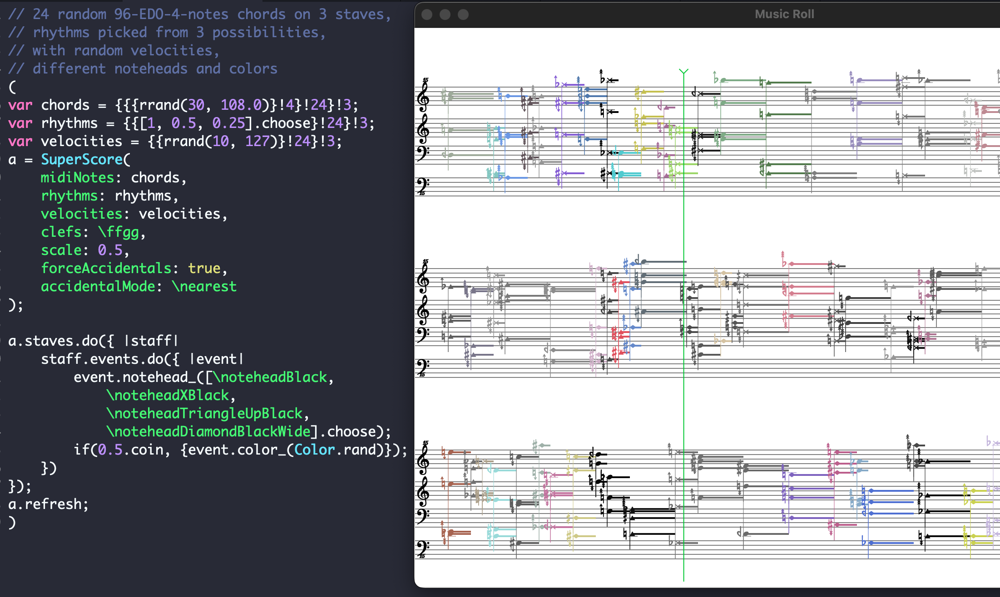

# SuperScore

> A class for displaying proportional notation natively in SuperCollider.
>


## Quickstart

### Installation

```supercollider
// install the quark
Quarks.install("https://github.com/claudiopanariello/SuperScore")

// recompile
thisProcess.recompile;
```

## Requirements

SuperScore requires these fonts, which are not included in this repository:

- [Bravura](https://github.com/steinbergmedia/bravura)
- [Petaluma](https://github.com/steinbergmedia/petaluma) (if you want a jazz-like font)

Install them system-wide, then restart SuperCollider.

For a smoother handling of the glyphs, SuperScore also requires `MITHUnicode`, available [here](https://github.com/ludions/scbook-2nd-edn/tree/main). It will need json files of the glyphs as well (these are included in this repository).

**CAVEAT**: if `MITHUnicode` is not installed, SuperScore will try to load the (a selection of) the glyphs the hard way.

## License

SuperScore is licensed under the GNU General Public License v3.0 or later (GPL-3.0-or-later). See [LICENSE](LICENSE).

Bravura and Petaluma are separate works by Steinberg, distributed under the SIL Open Font License.
